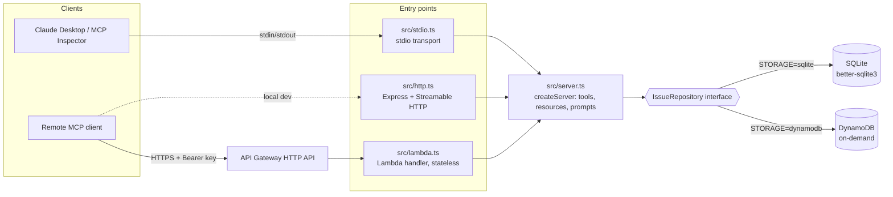
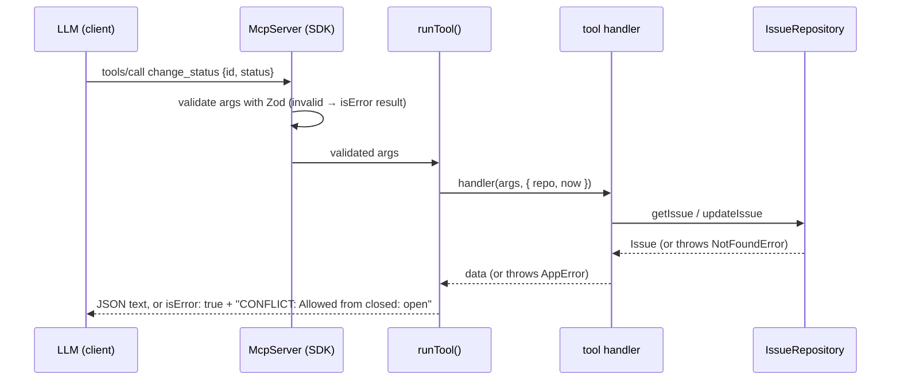
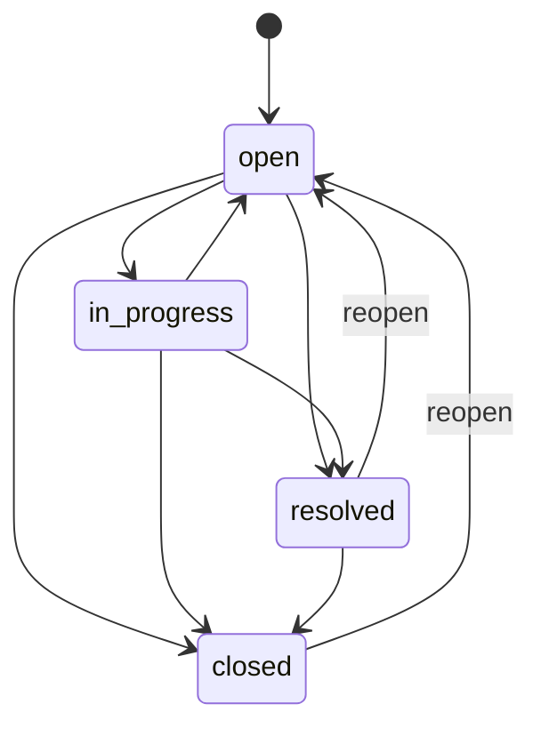
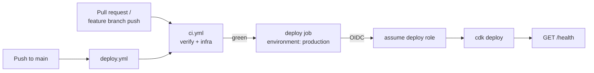
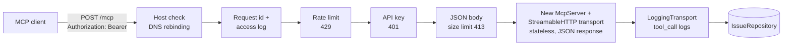
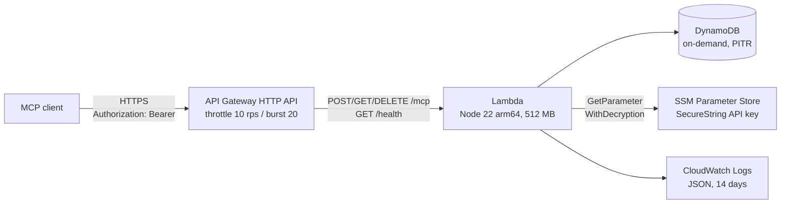

# Issue Tracker MCP Server

An [MCP (Model Context Protocol)](https://modelcontextprotocol.io) server that lets an LLM such as Claude
create, search, triage and report on software issues. It runs **locally over stdio** (Claude Desktop,
MCP Inspector) and **remotely over Streamable HTTP** on AWS Lambda, backed by SQLite or DynamoDB.

> Built as a learning and interview-portfolio project: the code is commented to explain _why_, not just _what_.

## Build status

| Phase | Scope                                                        | Status  |
| ----- | ------------------------------------------------------------ | ------- |
| 1     | Project setup, data model, SQLite repository                 | ✅ Done |
| 2     | MCP tools, resources, prompts + stdio transport              | ✅ Done |
| 3     | Vitest tests + MCP Inspector instructions                    | ✅ Done |
| 4     | Streamable HTTP transport, API-key auth, logging, rate limit | ✅ Done |
| 5     | DynamoDB repository, Lambda handler, IaC, CI/CD              | ✅ Done |

## Architecture



All three entry points share **one** `createServer()` function, so tool behaviour is identical whichever
transport is used. Only the wiring differs.

## Tech stack

- **Node.js 22**, TypeScript (strict, plus `noUncheckedIndexedAccess`), native ES modules
- **@modelcontextprotocol/sdk** (`McpServer`, `registerTool` / `registerResource` / `registerPrompt`)
- **Zod 4** for validation, the single source of truth for types
- **better-sqlite3** (local) / **AWS SDK v3 DynamoDB** (production)
- **Express 5** + Streamable HTTP; **AWS Lambda** (Node 22, arm64) via `@codegenie/serverless-express`
- **AWS CDK** (TypeScript) for infrastructure; **GitHub Actions** with OIDC for CI/CD
- **Vitest**, ESLint (typescript-eslint, type-aware), Prettier, DynamoDB Local for tests

> **Why Node 22 and not Node 20?** Node 20 reached end-of-life in April 2026, and current releases of
> Vitest require Node ≥ 22. Node 22 is the active LTS line and a supported AWS Lambda runtime.

## Project structure

```text
src/
  server.ts                  # createServer(): registers tools, resources, prompts (transport-agnostic)
  stdio.ts                   # stdio entry point (Claude Desktop, MCP Inspector)
  http.ts                    # Streamable HTTP entry point (listen + graceful shutdown)
  httpApp.ts                 # Express app: host check, logging, rate limit, auth, /mcp (stateless)
  context.ts                 # AppContext { repo, now, logger } injected everywhere
  config.ts                  # env vars → typed, validated config (fail fast)
  models/
    issue.ts                 # Zod schemas + derived types, limits, label helpers
    workflow.ts              # status transitions + priority definitions (single source)
  tools/
    types.ts                 # ToolDefinition: metadata + Zod shape + handler
    runTool.ts               # result/error → CallToolResult (isError: true)
    schemas.ts               # shared field schemas with .describe()
    format.ts                # description truncation for list/search output
    createIssue.ts … deleteIssue.ts   # one file per tool
  resources/                 # issues://summary, issues://workflow
  prompts/                   # triage_issues, weekly_report
  db/
    IssueRepository.ts       # storage interface (the contract)
    index.ts                 # createRepository(): picks backend from STORAGE
    sqlite/
      schema.ts              # tables + PRAGMA user_version migrations
      SqliteIssueRepository.ts
    dynamodb/
      table.ts               # single-table key design + createIssueTable (local/tests)
      DynamoIssueRepository.ts
  lib/
    errors.ts                # AppError + NotFound/Validation/Conflict/Config
    ids.ts                   # short prefixed IDs (iss_…, cmt_…)
    logger.ts                # JSON-lines logger to stderr, secret redaction
    loggingTransport.ts      # Transport decorator: logs every MCP request / tool call
    auth.ts                  # Bearer API-key middleware (constant-time compare)
  lambda.ts                  # Lambda handler: API Gateway → same Express app; key from SSM
tests/
  helpers.ts                 # controllable clock + in-memory repository
  db/repositoryContract.ts   # behaviour every IssueRepository must have (reused for DynamoDB)
  db/sqliteRepository.test.ts
  tools/                     # handler, runTool and input-schema tests
  prompts/ resources/ models/
  server.test.ts             # full MCP protocol via in-memory client ↔ server
scripts/
  seed.ts                    # demo data for Inspector / Claude Desktop
  create-dynamodb-table.ts   # table for DynamoDB Local
examples/claude_desktop_config.json
infra/                       # AWS CDK app (own package.json)
  bin/app.ts                 # stacks + context (cdk.json)
  lib/issue-tracker-stack.ts # API Gateway HTTP API + Lambda + DynamoDB + log group + budget
  lib/github-oidc-stack.ts   # one-time: OIDC provider + GitHub deploy role
  test/stacks.test.ts        # CloudFormation template assertions
.github/workflows/
  ci.yml                     # PRs/branches: format, lint, typecheck, tests (+ DynamoDB Local), infra synth
  deploy.yml                 # push to main: CI, then cdk deploy via OIDC + smoke test
```

## How MCP works in this project

MCP gives an LLM three kinds of capability. They differ by **who decides to use them**:

| Primitive     | Who triggers it                               | Side effects?  | In this project                                          |
| ------------- | --------------------------------------------- | -------------- | -------------------------------------------------------- |
| **Tools**     | The **model** decides to call them            | Yes (some)     | 8 tools to create, read, update, comment, search, delete |
| **Resources** | The **app / user** attaches them as context   | No (read-only) | `issues://summary`, `issues://workflow`                  |
| **Prompts**   | The **user** picks them (like slash commands) | No             | `triage_issues`, `weekly_report`                         |

### Tools

| Tool            | Use it to…                                                                | Hints       |
| --------------- | ------------------------------------------------------------------------- | ----------- |
| `create_issue`  | track new work (search first to avoid duplicates)                         |             |
| `get_issue`     | read one issue in full, with comments                                     | read-only   |
| `list_issues`   | filter by status / priority / assignee / label                            | read-only   |
| `search_issues` | find issues by words in title or description                              | read-only   |
| `update_issue`  | change title, description, priority, assignee (`null` = unassign), labels | idempotent  |
| `change_status` | move through the workflow; illegal moves are rejected                     | idempotent  |
| `add_comment`   | record progress or the reason for a change                                |             |
| `delete_issue`  | permanently delete, **only with `confirm: true`**                         | destructive |

How a tool call flows:



Every tool is a plain object (`name`, `description`, Zod `inputSchema`, `annotations`, `handler`), see
[`src/tools/types.ts`](src/tools/types.ts). Handlers return data or throw; `runTool()` alone decides how
results and errors look on the wire.

### Status workflow



Defined once in [`src/models/workflow.ts`](src/models/workflow.ts). `change_status` enforces it, and
`issues://workflow` renders it as markdown, so the docs the model reads always match the behaviour.

### Prompts

- **`triage_issues`** (`team?`: comma-separated usernames): loads all open issues and the current
  workload per person, and asks the model for a priority/assignee table. It tells the model **not** to
  apply anything until the user approves (human in the loop).
- **`weekly_report`** (`since?`: `YYYY-MM-DD`, default Monday of this week, UTC): loads issues
  created, resolved/closed, and still open, and asks for a short structured report.

Both embed issue data inside `<issues>` blocks and tell the model to treat it as data, not
instructions, a basic defence against prompt injection through issue text.

## Data model

| Issue         | Type                                              | Notes                                      |
| ------------- | ------------------------------------------------- | ------------------------------------------ |
| `id`          | string                                            | `iss_` + 12 hex chars                      |
| `title`       | string                                            | ≤ 200 chars                                |
| `description` | string                                            | ≤ 10 000 chars                             |
| `status`      | `open` \| `in_progress` \| `resolved` \| `closed` | new issues are always `open`               |
| `priority`    | `low` \| `medium` \| `high` \| `critical`         |                                            |
| `assignee`    | string \| null                                    | `null` = unassigned                        |
| `labels`      | string[]                                          | trimmed, lower-cased, de-duplicated, ≤ 20  |
| `createdAt`   | ISO-8601 UTC                                      |                                            |
| `updatedAt`   | ISO-8601 UTC                                      | bumped on every change, including comments |

| Comment     | Type         | Notes                  |
| ----------- | ------------ | ---------------------- |
| `id`        | string       | `cmt_` + 12 hex chars  |
| `issueId`   | string       | FK, cascades on delete |
| `author`    | string       | ≤ 100 chars            |
| `text`      | string       | ≤ 5 000 chars          |
| `createdAt` | ISO-8601 UTC |                        |

## Key design decisions

1. **Repository pattern.** Tools never touch SQL or DynamoDB directly; they call `IssueRepository`.
   The backend is chosen by `STORAGE=sqlite|dynamodb`, and the same test suite can run against both.
2. **Async interface over a sync driver.** better-sqlite3 is synchronous, but DynamoDB is not, so the
   interface is `Promise`-based. Declaring the SQLite methods `async` also means errors always surface
   as rejected promises, the same as with DynamoDB.
3. **Lazy backend loading.** `createRepository()` uses dynamic `import()`, so the Lambda bundle never
   loads the native SQLite addon.
4. **Zod as the source of truth.** Enums, limits and types are defined once in `models/issue.ts` and
   reused by tools, repositories and tests, so validation and types can't drift apart.
5. **LLM-friendly IDs.** Short prefixed IDs (`iss_3f9a1c2b7d4e`) are easier for a model to copy
   between tool calls than 36-character UUIDs, and random IDs work in DynamoDB (which has no sequences).
6. **Clear error contract.** Reads return `null` when an issue is missing; writes throw `NotFoundError`.
   Every `AppError` has a stable `code`, which later becomes an `isError: true` MCP result the LLM can act on.
7. **Guardrails at the data layer.** SQL uses bound parameters only; `LIKE` wildcards are escaped
   (searching `100%` matches the literal text); list limits are clamped to 1–200; SQLite `CHECK`
   constraints reject invalid statuses and priorities; foreign keys are switched on explicitly
   (SQLite leaves them off by default).
8. **Labels as a JSON column.** Labels are queried with `json_each()` instead of a join table. This
   mirrors how DynamoDB will store them and is plenty fast at this scale.
9. **Simple search.** A case-insensitive `LIKE` over title and description. SQLite FTS5 or OpenSearch
   would be the upgrade path, but they are overkill for a team-sized tracker and would not port to DynamoDB.
10. **Tool descriptions are prompt engineering.** Each description says _when_ to use the tool and
    which sibling to use instead (e.g. `update_issue` points to `change_status` for status changes).
    Every input field has `.describe()`, because that text becomes the JSON Schema the model reads.
11. **Errors the model can act on.** Failures come back as `isError: true` results with a code and
    a fix hint ("Allowed from closed: open"), not protocol errors, so the model can self-correct.
    Unexpected errors return a generic message; details go to stderr only.
12. **Token-aware output.** List and search results truncate descriptions to 200 characters and add
    a note when the limit was hit; `get_issue` returns the full text. Tool output fills the context window.
13. **Guardrail on destructive actions.** `delete_issue` requires `confirm: true` and is annotated
    `destructiveHint`; its description steers the model towards closing instead.
14. **One status path.** `update_issue` cannot change status (unknown fields are rejected), so every
    status change goes through the workflow check in `change_status`.
15. **Absolute default DB path.** Claude Desktop launches servers from an unpredictable working
    directory, so the default `SQLITE_PATH` resolves to `<project>/data/issues.db`, not `./data`.
16. **Stateless Streamable HTTP.** Each `POST /mcp` gets a fresh server and transport with no session
    id, so any instance can answer any request. That is what lets it run on Lambda. The
    trade-off is no server-initiated messages, which this server doesn't use.
17. **JSON responses, not SSE.** `enableJsonResponse` returns one JSON body per request. API Gateway +
    Lambda buffers responses anyway, and plain JSON is easier to debug with `curl`.
18. **Log at the transport, not in each tool.** `LoggingTransport` decorates any `Transport` and sees
    every request, including calls the SDK rejects before a handler runs. Logging inside handlers
    would silently miss those. The same class serves stdio, HTTP and Lambda.
19. **Log metadata, never content.** Tool name, duration, outcome and error code are logged; tool
    arguments, results and the `Authorization` header are not. Secret-looking keys are redacted as a
    second line of defence.
20. **Middleware order is a security decision.** The rate limit runs before auth, so key guessing is
    throttled; auth runs before body parsing, so unauthenticated callers can't make the server parse
    large payloads.
21. **DynamoDB single-table design.** An issue and its comments share a partition, so "issue +
    comments" is one query and a delete finds everything in one place. Two GSIs serve the access
    patterns: newest-first listing (`gsi1`) and by-status listing (`gsi2`).
22. **"Limit" means matches, not reads.** DynamoDB's `Limit` counts items _read_ before the
    `FilterExpression`, so the repository keeps paging until it has collected enough _matches_. The
    contract suite runs a second time with 1-item pages to prove it.
23. **One Express app everywhere.** Lambda runs the same app as `npm run dev:http` through
    serverless-express, so auth, limits and logging are tested once and behave identically in AWS.
24. **API key in SSM Parameter Store, read at runtime.** Lambda gets only the parameter _name_; the
    SecureString value never appears in the template, the repository or the function's
    configuration. Standard parameters are free, whereas Secrets Manager costs about $0.40 per secret
    per month and its rotation features aren't needed here.
25. **Cheapest sensible AWS building blocks.** An HTTP API instead of a REST API, Lambda on arm64,
    DynamoDB on-demand, two-week log retention, and stage throttling as a spending cap.
26. **No long-lived AWS keys in CI.** GitHub Actions assumes a role through OIDC. The trust policy
    pins the exact repository _and_ the `production` environment, and the role may only assume the
    CDK bootstrap roles. The subject uses GitHub's **immutable numeric IDs**
    (`repo:owner@<ownerId>/repo@<repoId>:environment:production`, set via `githubOwnerId` /
    `githubRepositoryId` in `cdk.json`), so a re-created repository with the same name can't match.
27. **Data outlives the stack.** The table has `RemovalPolicy.RETAIN` and point-in-time recovery, so
    `cdk destroy` or a bad refactor can't silently delete production data.

**Known limitation:** there is no status history, so `weekly_report` counts an issue as "resolved this
week" if it is currently resolved/closed and was last updated this week. A `resolvedAt` field or an
activity log would make this exact.

## Local setup

```bash
nvm use            # Node 22 (see .nvmrc)
npm install
npm run build
npm run dev:stdio  # run from source with tsx (speaks MCP on stdin/stdout)
```

The SQLite database is created automatically on first use (default `<project>/data/issues.db`,
git-ignored), and schema migrations run on startup. Environment variables are passed by the MCP
client (for example the `env` block in Claude Desktop's config) or your shell. `.env.example` lists them.

| Script                          | What it does                                  |
| ------------------------------- | --------------------------------------------- |
| `npm run dev:stdio`             | run the stdio server from TypeScript (tsx)    |
| `npm run start:stdio`           | run the compiled server (`dist/stdio.js`)     |
| `npm run dev:http`              | run the HTTP server from TypeScript (tsx)     |
| `npm run start:http`            | run the compiled HTTP server (`dist/http.js`) |
| `npm run build`                 | compile `src/` to `dist/`                     |
| `npm run lint`                  | ESLint (type-aware)                           |
| `npm run typecheck`             | `tsc --noEmit` over src and tests             |
| `npm test`                      | Vitest                                        |
| `npm run test:coverage`         | Vitest with coverage + thresholds             |
| `npm run seed`                  | add demo issues (only if the DB is empty)     |
| `npm run inspector`             | build, then open MCP Inspector on the server  |
| `npm run dynamodb:create-table` | create the table in DynamoDB Local            |

## Environment variables

| Variable                | Default                    | Used by | Description                                                     |
| ----------------------- | -------------------------- | ------- | --------------------------------------------------------------- |
| `STORAGE`               | `sqlite`                   | all     | `sqlite` or `dynamodb`                                          |
| `SQLITE_PATH`           | `<project>/data/issues.db` | all     | SQLite file path; `:memory:` for throwaway                      |
| `LOG_LEVEL`             | `info`                     | all     | `debug` also logs non-tool requests (list, ping) and `/health`  |
| `MCP_API_KEY`           | _(required)_               | HTTP    | Bearer token clients must send; at least 32 characters          |
| `PORT`                  | `3000`                     | HTTP    | Listen port                                                     |
| `HOST`                  | `127.0.0.1`                | HTTP    | Listen address; loopback enables the localhost Host check       |
| `RATE_LIMIT_PER_MINUTE` | `60`                       | HTTP    | Requests per client IP per minute (including failed auth)       |
| `MAX_BODY_BYTES`        | `102400`                   | HTTP    | Max JSON body size (1 KB to 1 MB)                               |
| `ALLOWED_HOSTS`         | _(unset)_                  | HTTP    | Comma-separated Host header allow-list (DNS-rebinding defence)  |
| `TRUST_PROXY`           | `0`                        | HTTP    | Proxy hops to trust for the client IP (set behind a proxy)      |
| `DYNAMODB_TABLE`        | _(unset)_                  | all     | Table name; required when `STORAGE=dynamodb`                    |
| `DYNAMODB_ENDPOINT`     | _(unset)_                  | all     | DynamoDB Local URL (e.g. `http://localhost:8000`); unset on AWS |
| `AWS_REGION`            | _(from AWS)_               | all     | Region for DynamoDB/SSM (Lambda sets it automatically)          |
| `MCP_API_KEY_PARAMETER` | _(unset)_                  | Lambda  | SSM SecureString parameter holding the API key (set by CDK)     |

## CI/CD



- [`ci.yml`](.github/workflows/ci.yml) runs on pull requests and feature-branch pushes, and is reused
  by the deploy workflow. It has two jobs:
  - **verify:** format → lint → typecheck → tests with coverage (with DynamoDB Local as a service
    container, so the DynamoDB contract tests run too) → build.
  - **infra:** typecheck → CloudFormation template tests → `cdk synth`. Synth needs no AWS
    credentials.
- [`deploy.yml`](.github/workflows/deploy.yml) runs on every push to `main`. It runs CI first, then
  the deploy job in the `production` GitHub Environment: it assumes the AWS role through OIDC, runs
  `cdk deploy`, smoke-tests `/health`, and writes the endpoint to the run summary. Deployments never
  run concurrently and are never cancelled half-way. Until the `production` environment is
  configured (step 5 of "AWS deployment"), the deploy job fails at the credentials step while CI still
  passes.

Branching follows GitHub Flow: one short-lived branch per phase (`2-mcp-tools-stdio`, …), a pull request
into `main`, CI must pass, then squash merge.

## Testing

### Automated tests (Vitest)

```bash
npm test               # SQLite + unit tests; DynamoDB tests are skipped without DynamoDB Local

# Full suite including the DynamoDB contract tests (what CI runs):
docker run -d --rm -p 8000:8000 amazon/dynamodb-local -jar DynamoDBLocal.jar -inMemory
DYNAMODB_ENDPOINT=http://localhost:8000 npm test   # ~245 tests
npm run test:coverage  # same, plus coverage report (coverage/index.html); CI fails below the floor
```

The suite is layered so each kind of failure shows up in exactly one place:

| Layer                 | File(s)                                     | What it proves                                                                                                        |
| --------------------- | ------------------------------------------- | --------------------------------------------------------------------------------------------------------------------- |
| Repository contract   | `tests/db/repositoryContract.ts`            | Behaviour any storage backend must have: filters, ordering, partial updates, cascades, search escaping, summary       |
| SQLite specifics      | `tests/db/sqliteRepository.test.ts`         | File persistence, migrations, foreign keys, `CHECK` constraints                                                       |
| Models                | `tests/models/models.test.ts`               | Label normalisation, limit clamping, the full status-transition matrix, config validation                             |
| Tool handlers         | `tests/tools/tools.test.ts`                 | Each tool's happy path and failure modes (not found, illegal transition, delete without confirm)                      |
| Error mapping         | `tests/tools/runTool.test.ts`               | `AppError` → `isError` with code; unexpected errors never leak details                                                |
| Input validation      | `tests/tools/schemas.test.ts`               | Size limits, trimming, enums: the guardrail between the LLM and the database                                          |
| Prompts and resources | `tests/prompts/`, `tests/resources/`        | Weekly window maths, report grouping, triage content, injection data blocks, workflow docs                            |
| Protocol              | `tests/server.test.ts`                      | A real MCP `Client` over `InMemoryTransport`: listing, JSON Schema descriptions, SDK validation                       |
| HTTP transport        | `tests/http/httpApp.test.ts`                | Auth, 413/400/404/405/429, Host check, stateless MCP over HTTP, request-id correlated logs (supertest)                |
| HTTP config and auth  | `tests/http/config.test.ts`, `auth.test.ts` | Required/minimum-length API key (never echoed), bearer parsing, constant-time compare                                 |
| Logging               | `tests/lib/`                                | JSON shape, levels, redaction; every tool call logged with outcome/code, arguments never logged                       |
| DynamoDB              | `tests/db/dynamoRepository.test.ts`         | The same contract against DynamoDB Local (twice: default and 1-item pages), 25+ item batch delete, factory            |
| Lambda                | `tests/lambda.test.ts`                      | API Gateway v2 events → handler: auth, tools, 413 on pre-read bodies, client IP, SSM key loading, cold-start retry    |
| Infrastructure        | `infra/test/stacks.test.ts`                 | Template: on-demand table + GSIs + PITR + retain, Node 22/arm64, no secret in env, scoped IAM, throttling, OIDC trust |
| Lambda bundle         | `infra/test/bundle.test.ts`                 | The bundled `index.mjs` loads and serves `/health` from an empty directory, with no `node_modules` (like `/var/task`) |

Design choices worth knowing:

- **No mocks of our own code.** Tests use a real SQLite `:memory:` database. It's fast (the whole
  suite runs in under a second) and catches real SQL bugs that mocks would hide.
- **Deterministic time.** A controllable clock is injected into the repository and prompts, so
  ordering and "this week" logic never depend on when the tests run.
- **A contract suite.** `describeRepositoryContract()` takes a factory, so the DynamoDB repository must pass the same tests. That's the proof the backends are interchangeable.

### Manual testing with MCP Inspector

[MCP Inspector](https://github.com/modelcontextprotocol/inspector) is the official debugging UI for MCP
servers: it lists tools, resources and prompts, and lets you call them with a form.

```bash
npm run seed       # optional: 7 realistic demo issues
npm run inspector  # builds, then opens http://localhost:6274 in your browser
```

In the Inspector UI the transport is already set to **STDIO** with `node dist/stdio.js`. Click
**Connect**, then try:

1. **Tools → list_issues** with `status = open`: shortened descriptions, newest first.
2. **Tools → change_status** on a closed issue with `status = resolved`: an `isError` result
   explaining that only `open` is allowed.
3. **Tools → delete_issue** with `confirm` unchecked: refused.
4. **Resources → issues://summary** and **issues://workflow**.
5. **Prompts → triage_issues** with `team = alice, bob`: the fully rendered prompt text.
6. The **History** pane shows every JSON-RPC request and response, which is useful for seeing exactly what
   an LLM client would receive.

Inspector also has a scriptable CLI mode, handy for quick checks:

```bash
npx @modelcontextprotocol/inspector --cli node dist/stdio.js --method tools/list
npx @modelcontextprotocol/inspector --cli node dist/stdio.js \
  --method tools/call --tool-name search_issues --tool-arg keyword=payment
npx @modelcontextprotocol/inspector --cli node dist/stdio.js \
  --method resources/read --uri issues://summary
```

> Recent Inspector releases ask for Node ≥ 22.23. Older 22.x versions still work but print an
> `EBADENGINE` warning; `nvm install 22` gets the latest 22.x.

### Using it from Claude Desktop

1. `npm run build` (Claude Desktop runs the compiled `dist/stdio.js`).
2. Open **Settings → Developer → Edit Config** (this edits `claude_desktop_config.json`) and add the
   block from [`examples/claude_desktop_config.json`](examples/claude_desktop_config.json):

   ```json
   {
     "mcpServers": {
       "issue-tracker": {
         "command": "/ABSOLUTE/PATH/TO/node",
         "args": ["/ABSOLUTE/PATH/TO/issue-tracker-mcp/dist/stdio.js"],
         "env": {
           "STORAGE": "sqlite",
           "SQLITE_PATH": "/ABSOLUTE/PATH/TO/issue-tracker-mcp/data/issues.db"
         }
       }
     }
   }
   ```

3. Fully quit and restart Claude Desktop. The `issue-tracker` server and its tools show up in the
   chat's tools/connectors menu; its prompts and resources can be added to a chat from the same
   area.
4. Try: _"What critical issues are open?"_, _"Start working on the checkout timeout and note that
   the SDK timeout is the cause"_, or run the **weekly_report** prompt.

Gotchas this config avoids:

- **Use absolute paths everywhere.** Claude Desktop does not start in the project folder and does
  not load your shell profile, so `node` from nvm is often not on its `PATH`. Find yours with
  `which node`.
- **Use the same Node major version you ran `npm install` with.** better-sqlite3 is a native addon
  compiled for one Node ABI; running it with a different major version fails with
  `NODE_MODULE_VERSION` errors.
- Logs are in `~/Library/Logs/Claude/mcp-server-issue-tracker.log` (macOS).

### Using it from Claude Code

```bash
claude mcp add issue-tracker -- node /ABSOLUTE/PATH/TO/issue-tracker-mcp/dist/stdio.js
```

## Remote access: Streamable HTTP

Run the same server over HTTP, so it can be reached from other machines or from AWS Lambda:

```bash
export MCP_API_KEY=$(openssl rand -hex 32)   # 64 hex chars; keep it secret
npm run dev:http                             # http://127.0.0.1:3000/mcp
```

A request goes through this pipeline:



Try it with `curl`:

```bash
# Health check (no auth)
curl -s http://127.0.0.1:3000/health

# List tools
curl -s http://127.0.0.1:3000/mcp \
  -H "Authorization: Bearer $MCP_API_KEY" \
  -H "Content-Type: application/json" \
  -H "Accept: application/json, text/event-stream" \
  -d '{"jsonrpc":"2.0","id":1,"method":"tools/list"}'

# Call a tool
curl -s http://127.0.0.1:3000/mcp \
  -H "Authorization: Bearer $MCP_API_KEY" \
  -H "Content-Type: application/json" \
  -H "Accept: application/json, text/event-stream" \
  -d '{"jsonrpc":"2.0","id":2,"method":"tools/call","params":{"name":"list_issues","arguments":{"status":"open"}}}'
```

Connect a client:

- **MCP Inspector:** run `npx @modelcontextprotocol/inspector`, choose transport **Streamable HTTP**,
  URL `http://127.0.0.1:3000/mcp`, and add an `Authorization: Bearer <key>` header in the
  authentication settings.
- **Claude Code:**

  ```bash
  claude mcp add --transport http issue-tracker http://127.0.0.1:3000/mcp \
    --header "Authorization: Bearer $MCP_API_KEY"
  ```

## Security and guardrails

| Threat                                      | Mitigation                                                                                          |
| ------------------------------------------- | --------------------------------------------------------------------------------------------------- |
| Unauthenticated access                      | `Authorization: Bearer` API key, compared in constant time; 401 + `WWW-Authenticate`                |
| Weak or leaked keys                         | Minimum 32 characters, never logged or echoed in errors; on AWS it lives in SSM Parameter Store     |
| Brute force / abuse                         | Per-IP rate limit (also counts failed auth); on AWS, API Gateway throttling is added on top         |
| Huge payloads                               | `MAX_BODY_BYTES` body limit (413), per-field Zod limits, list results capped at 200                 |
| DNS rebinding against a local server        | Host header validation (localhost by default, `ALLOWED_HOSTS` otherwise)                            |
| SQL injection                               | Bound parameters only; `LIKE` wildcards escaped                                                     |
| Accidental destructive actions by the model | `delete_issue` requires `confirm: true`; annotated `destructiveHint`                                |
| Prompt injection via issue text             | Prompts wrap issue data in `<issues>` blocks marked as data                                         |
| Information leaks                           | Unexpected errors return a generic message; `x-powered-by` disabled; logs exclude arguments/results |

A single shared API key suits a personal or team server. A multi-user product would implement the
MCP authorization spec (OAuth 2.1 with per-user tokens and scopes), so each tool call could be
attributed to, and authorized for, a specific user.

## Logging

Every log line is one JSON object on **stderr** (stdout belongs to the stdio protocol; on Lambda,
stderr goes to CloudWatch). Every tool call produces exactly one `tool_call` entry:

```json
{"time":"2026-11-20T08:12:40.983Z","level":"info","msg":"tool call","service":"issue-tracker-mcp","requestId":"40c62ce6-…","event":"tool_call","method":"tools/call","tool":"create_issue","durationMs":1.34,"outcome":"success"}
{"time":"2026-11-20T08:12:40.988Z","level":"warn","msg":"tool call failed","service":"issue-tracker-mcp","requestId":"b1fac43f-…","event":"tool_call","method":"tools/call","tool":"change_status","durationMs":0.42,"outcome":"tool_error","errorCode":"INVALID_INPUT"}
```

| `outcome`    | Meaning                                                                        | `errorCode` examples                                 |
| ------------ | ------------------------------------------------------------------------------ | ---------------------------------------------------- |
| `success`    | Tool returned a normal result                                                  | none                                                 |
| `tool_error` | Tool returned `isError: true` (domain error, or arguments rejected by the SDK) | `NOT_FOUND`, `CONFLICT`, `INVALID_INPUT`, `INTERNAL` |
| `rpc_error`  | JSON-RPC level failure (unknown resource, bad method)                          | `RPC_-32602`                                         |

HTTP requests also get an `http_request` access-log line, plus `auth_failed` and `rate_limited`
events. They all share the request's `requestId`, which is taken from the client's `x-request-id`
header if it's safe, generated otherwise, and returned in the response header.

**Never logged:** tool arguments, tool results, the `Authorization` header or API key. Keys named like
`authorization`, `apiKey`, `token`, `secret`, `password` or `cookie` are redacted at any depth as a
safety net.

## Storage on AWS: DynamoDB single-table design

| Item    | `pk`         | `sk`                          | `gsi1pk` / `gsi1sk`           | `gsi2pk` / `gsi2sk`                    |
| ------- | ------------ | ----------------------------- | ----------------------------- | -------------------------------------- |
| Issue   | `ISSUE#<id>` | `META`                        | `ISSUES` / `<createdAt>#<id>` | `STATUS#<status>` / `<createdAt>#<id>` |
| Comment | `ISSUE#<id>` | `COMMENT#<createdAt>#<cmtId>` | none                          | none                                   |

| Access pattern                       | How                                                                         |
| ------------------------------------ | --------------------------------------------------------------------------- |
| Get issue                            | `GetItem(pk, META)`, strongly consistent                                    |
| Issue's comments, oldest first       | `Query(pk, begins_with(sk, "COMMENT#"))`                                    |
| List newest first (+ createdAfter)   | `Query gsi1`, `ScanIndexForward=false`, `gsi1sk >= createdAfter`            |
| List by status                       | `Query gsi2` on `STATUS#<status>`: a key lookup, not a filter               |
| Priority / assignee / label / search | `FilterExpression` on lower-cased copies, paging until enough matches       |
| Delete issue + comments              | `Query(pk)` → `BatchWriteItem` in chunks of 25 (comments first, issue last) |
| Add comment                          | `TransactWriteItems`: bump issue `updatedAt` (must exist) + put comment     |

Limits worth knowing: `gsi1` keeps all issues in one partition, which is fine up to thousands of
writes per second (shard the key beyond that). Search scans issues newest first with a filter, which is
fine for thousands of issues; OpenSearch would be the upgrade. Listings come from GSIs, which are
eventually consistent, so a just-created issue can take a moment to appear in `list_issues`.

Run the server against DynamoDB Local:

```bash
docker run -d -p 8000:8000 amazon/dynamodb-local -jar DynamoDBLocal.jar -sharedDb
export STORAGE=dynamodb DYNAMODB_ENDPOINT=http://localhost:8000 DYNAMODB_TABLE=issues
npm run dynamodb:create-table
npm run dev:stdio   # or dev:http
```

## AWS deployment



### Prerequisites

- An AWS account and the AWS CLI signed in (`aws sts get-caller-identity` should work), with
  permissions to create the resources above (an admin role for the first deployment).
- Node 22. Docker is **not** needed: esbuild bundles the Lambda locally.

### 1. Set a budget alert first

Do this before deploying anything, so a mistake can never surprise you on the bill. Either:

- **Console:** Billing and Cost Management → Budgets → Create budget → _Monthly cost budget_ →
  $10 → your email; or
- **CLI:**

  ```bash
  ACCOUNT_ID=$(aws sts get-caller-identity --query Account --output text)
  aws budgets create-budget --account-id "$ACCOUNT_ID" \
    --budget '{"BudgetName":"monthly-10-usd","BudgetLimit":{"Amount":"10","Unit":"USD"},"TimeUnit":"MONTHLY","BudgetType":"COST"}' \
    --notifications-with-subscribers '[
      {"Notification":{"NotificationType":"ACTUAL","ComparisonOperator":"GREATER_THAN","Threshold":80,"ThresholdType":"PERCENTAGE"},
       "Subscribers":[{"SubscriptionType":"EMAIL","Address":"you@example.com"}]},
      {"Notification":{"NotificationType":"FORECASTED","ComparisonOperator":"GREATER_THAN","Threshold":100,"ThresholdType":"PERCENTAGE"},
       "Subscribers":[{"SubscriptionType":"EMAIL","Address":"you@example.com"}]}]'
  ```

- **Or with the stack:** add `-c budgetEmail=you@example.com` to `cdk deploy`, or set the
  `BUDGET_EMAIL` variable for CI, and the stack creates the same budget.

A budget **alerts**; it does not stop spending. The hard limits here are API Gateway throttling and
on-demand pricing that is $0 when idle. Budgets cover the whole account, not just this project.

### 2. Create the API key in SSM (once)

```bash
aws ssm put-parameter \
  --name /issue-tracker-mcp/api-key \
  --type SecureString \
  --value "$(openssl rand -hex 32)"

# Read it back when you need it for a client:
aws ssm get-parameter --name /issue-tracker-mcp/api-key --with-decryption \
  --query Parameter.Value --output text
```

CloudFormation can't create SecureString parameters. That's a good thing: the secret is created out
of band and never passes through code or templates.

### 3. Bootstrap CDK and deploy

```bash
cd infra
npm ci
npx cdk bootstrap                  # once per account/region
npx cdk diff IssueTrackerMcp       # review what will be created
npx cdk deploy IssueTrackerMcp     # ~2 minutes; prints McpEndpoint and HealthUrl
```

### 4. Try it

```bash
export MCP_URL=<McpEndpoint output>     # https://xxxx.execute-api.<region>.amazonaws.com/mcp
export MCP_API_KEY=$(aws ssm get-parameter --name /issue-tracker-mcp/api-key --with-decryption \
  --query Parameter.Value --output text)

curl -s "${MCP_URL%/mcp}/health"
curl -s "$MCP_URL" -H "Authorization: Bearer $MCP_API_KEY" -H "Content-Type: application/json" \
  -H "Accept: application/json, text/event-stream" \
  -d '{"jsonrpc":"2.0","id":1,"method":"tools/list"}'

# Use it from Claude Code:
claude mcp add --transport http issue-tracker-aws "$MCP_URL" \
  --header "Authorization: Bearer $MCP_API_KEY"
```

### 5. Turn on continuous deployment (once)

1. Deploy the OIDC stack, which creates the GitHub identity provider and a deploy role that can only
   assume the CDK bootstrap roles:

   ```bash
   cd infra && npx cdk deploy IssueTrackerMcpGitHubOidc
   ```

   If your account already has a GitHub OIDC provider, add
   `-c githubOidcProviderArn=arn:aws:iam::<account>:oidc-provider/token.actions.githubusercontent.com`.

2. In GitHub, open **Settings → Environments → New environment** and name it `production`.
   Optionally add yourself as a required reviewer, so every deploy waits for approval.
3. In that environment, add these **variables** (not secrets; none of them are sensitive):
   `AWS_DEPLOY_ROLE_ARN` (the `DeployRoleArn` output), `AWS_REGION`, and optionally `BUDGET_EMAIL`.
4. Merge to `main`. `deploy.yml` runs CI, deploys and smoke-tests `/health`.

### Operating it

- **Logs:** CloudWatch → Logs Insights → log group `LogGroupName` (stack output):

  ```text
  fields @timestamp, tool, outcome, errorCode, durationMs
  | filter event = "tool_call"
  | stats count() as calls, avg(durationMs) as avgMs, max(durationMs) as maxMs by tool, outcome
  ```

- **Rotate the API key:** run `aws ssm put-parameter --name /issue-tracker-mcp/api-key --type
SecureString --overwrite --value "$(openssl rand -hex 32)"`. Running containers cache the key, so
  force fresh ones with any configuration change, e.g.
  `aws lambda update-function-configuration --function-name <FunctionName> --description "key rotated $(date -u +%FT%TZ)"`.
- **Tear down:** `cd infra && npx cdk destroy IssueTrackerMcp`. The table is **retained** on purpose;
  delete it in the DynamoDB console when you're sure, along with the SSM parameter.

## Cost

Rough monthly cost for light personal or team use (about 10,000 MCP requests/month), using us-east-1
list prices at the time of writing. Check the [AWS Pricing Calculator](https://calculator.aws/) for
your region.

| Service                         | Pricing model                                                  | Estimate       |
| ------------------------------- | -------------------------------------------------------------- | -------------- |
| API Gateway HTTP API            | about $1.00 per million requests                               | ~$0.01         |
| Lambda (arm64, 512 MB)          | per request + GB-second; the always-free allowance covers this | $0             |
| DynamoDB on-demand              | per read/write request + storage (first 25 GB free)            | < $0.05        |
| DynamoDB point-in-time recovery | per GB-month of table size                                     | ~$0            |
| CloudWatch Logs (14 days)       | about $0.50 per GB ingested                                    | < $0.05        |
| SSM Parameter Store             | standard parameters are free                                   | $0             |
| CDK bootstrap (S3 + ECR)        | storage for deployment assets                                  | < $0.10        |
| **Total**                       |                                                                | **< $1/month** |

What keeps it under $10 even if usage grows or the key leaks: API Gateway throttling (10 req/s,
burst 20), no always-on compute, two-week log retention, and the budget alert.

## Interview talking points

**MCP fundamentals**

- MCP has three primitives, each controlled by a different party: **tools** are chosen by the model,
  **resources** are attached by the app or user, and **prompts** are picked by the user. I used each
  for what it's good at: actions, read-only context, and reusable workflows.
- Tool descriptions and `.describe()` texts are prompt engineering. They tell the model _when_ to use
  a tool and which sibling to use instead, and errors come back as `isError` results with a hint
  ("Allowed from closed: open") so the model can self-correct.
- I designed for LLM ergonomics: short prefixed IDs, truncated list output (token budget), idempotent
  `change_status`, and a `confirm: true` guardrail plus `destructiveHint` on delete.

**Architecture**

- One transport-agnostic `createServer()`, three entry points (stdio, HTTP, Lambda). Behaviour is
  identical everywhere, and tests drive it through an in-memory transport.
- The repository pattern with a **contract test suite**: SQLite and DynamoDB pass the same 30+
  behavioural tests, which proves `STORAGE` really is a drop-in switch.
- Stateless Streamable HTTP is the key to serverless: no session affinity, so any Lambda instance can
  serve any request.

**DynamoDB**

- A single-table design driven by access patterns: issue and comments in one partition, two GSIs for
  newest-first and by-status listing.
- The subtle bug class: `Limit` applies _before_ `FilterExpression`. I page until enough matches are
  collected, and test it with 1-item pages.
- Explicit trade-offs: a hot partition at extreme scale, scan-based search, eventual consistency on
  GSIs, and non-atomic large deletes ordered so that a retry is safe.

**Security**

- Defence in depth: constant-time API-key comparison, rate limiting _before_ auth, auth _before_
  body parsing, size limits, Host-header validation, bound SQL parameters, and prompt-injection
  framing for user-written text.
- Secrets: the key lives in SSM SecureString and is read at runtime, never in code, templates, env
  vars or logs. CI uses OIDC with a trust policy pinned to one repo and environment, so there are no
  stored AWS keys.
- Logging is metadata-only (tool, duration, outcome, error code) with secret redaction as a backstop.

**Testing and delivery**

- Tests are layered: contract, handler, protocol (real MCP client), HTTP (supertest), Lambda (real
  API Gateway events) and infrastructure (template assertions), with coverage thresholds enforced in
  CI.
- One real bug found by testing the _bundled_ Lambda: serverless-express hands Express a pre-read
  body, so `express.json()` silently skipped it, which also bypassed the body-size limit. I fixed it
  with a middleware that parses the Buffer under the same limit, and added a regression test.
- A second one found only by the **first real deployment**: esbuild hoisted the lazily-loaded SQLite
  module's `import 'better-sqlite3'` to the top of the single-file bundle, so Lambda crashed at init
  with `ERR_MODULE_NOT_FOUND`. My local bundle test had passed because Node quietly resolved the
  package from the repo's `node_modules`. The fix loads the native driver lazily via `createRequire`,
  and the new `infra/test/bundle.test.ts` imports the bundle from an empty temp directory (like
  `/var/task`). It fails without the fix and passes with it. Lesson: test artifacts in isolation.
- A CI/CD gotcha: I first guarded the deploy job with `if: vars.AWS_DEPLOY_ROLE_ARN != ''`, which
  skipped it forever. A job-level `if` is evaluated before the job enters its environment, so
  environment-scoped variables are always empty there. Caught on the first merge by checking the job
  had actually run, not just that the workflow was green.
- A third, also caught only on the real deploy: OIDC `AccessDenied`. I diagnosed it from evidence
  rather than guesswork: CloudTrail's rejected `AssumeRoleWithWebIdentity` events show the token's
  actual `sub` claim, which GitHub now builds with immutable owner/repo IDs. The trust policy now pins
  that exact ID-based subject, and a test asserts it.
- GitHub Flow with one PR per phase; `main` deploys automatically after CI, through a protected
  environment.

**What I'd do next**

- OAuth 2.1 per the MCP authorization spec (per-user identity and scopes) instead of a shared key.
- A status-history table, so "resolved this week" is exact.
- Full-text search (OpenSearch) and counters maintained via DynamoDB Streams, if scale demands it.
- A custom domain, AWS WAF, and alarms on Lambda errors and throttles.
