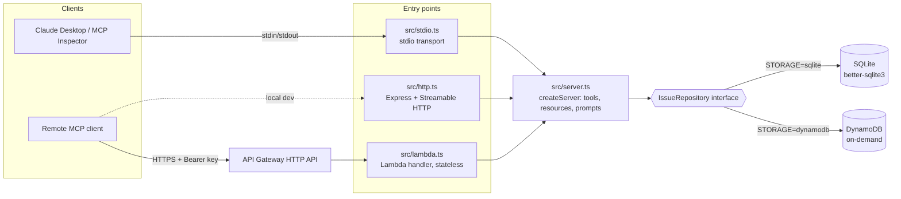

# Issue Tracker MCP Server

An [MCP (Model Context Protocol)](https://modelcontextprotocol.io) server that lets an LLM such as Claude
create, search, triage and report on software issues. It runs **locally over stdio** (Claude Desktop,
MCP Inspector) and **remotely over Streamable HTTP** on AWS Lambda, backed by SQLite or DynamoDB.

> Built as a learning and interview-portfolio project: the code is commented to explain _why_, not just _what_.

## Build status

| Phase | Scope                                                        | Status  |
| ----- | ------------------------------------------------------------ | ------- |
| 1     | Project setup, data model, SQLite repository                 | ✅ Done |
| 2     | MCP tools, resources, prompts + stdio transport              | ⏳ Next |
| 3     | Vitest tests + MCP Inspector instructions                    | ⏳      |
| 4     | Streamable HTTP transport, API-key auth, logging, rate limit | ⏳      |
| 5     | DynamoDB repository, Lambda handler, IaC, CI/CD              | ⏳      |

## Architecture (target)



All three entry points share **one** `createServer()` function, so tool behaviour is identical whichever
transport is used. Only the wiring differs.

## Tech stack

- **Node.js 22**, TypeScript (strict, plus `noUncheckedIndexedAccess`), native ES modules
- **@modelcontextprotocol/sdk** (`McpServer`, `registerTool` / `registerResource` / `registerPrompt`)
- **Zod 4** for validation, the single source of truth for types
- **better-sqlite3** (local) / **AWS SDK v3 DynamoDB** (production)
- **Vitest**, ESLint (typescript-eslint, type-aware), Prettier

> **Why Node 22 and not Node 20?** Node 20 reached end-of-life in April 2026, and current releases of
> Vitest require Node ≥ 22. Node 22 is the active LTS line and a supported AWS Lambda runtime.

## Project structure

```text
src/
  config.ts                  # env vars → typed, validated config (fail fast)
  models/issue.ts            # Zod schemas + derived types, limits, label helpers
  db/
    IssueRepository.ts       # storage interface (the contract)
    index.ts                 # createRepository(): picks backend from STORAGE
    sqlite/
      schema.ts              # tables + PRAGMA user_version migrations
      SqliteIssueRepository.ts
  lib/
    errors.ts                # AppError + NotFound/Validation/Conflict/Config
    ids.ts                   # short prefixed IDs (iss_…, cmt_…)
  # coming next: server.ts, stdio.ts, http.ts, lambda.ts, tools/, resources/, prompts/
tests/                       # phase 3
infra/                       # phase 5
```

## Data model

| Issue         | Type                                              | Notes                                      |
| ------------- | ------------------------------------------------- | ------------------------------------------ |
| `id`          | string                                            | `iss_` + 12 hex chars                      |
| `title`       | string                                            | ≤ 200 chars                                |
| `description` | string                                            | ≤ 10 000 chars                             |
| `status`      | `open` \| `in_progress` \| `resolved` \| `closed` | new issues are always `open`               |
| `priority`    | `low` \| `medium` \| `high` \| `critical`         |                                            |
| `assignee`    | string \| null                                    | `null` = unassigned                        |
| `labels`      | string[]                                          | trimmed, lower-cased, de-duplicated, ≤ 20  |
| `createdAt`   | ISO-8601 UTC                                      |                                            |
| `updatedAt`   | ISO-8601 UTC                                      | bumped on every change, including comments |

| Comment     | Type         | Notes                  |
| ----------- | ------------ | ---------------------- |
| `id`        | string       | `cmt_` + 12 hex chars  |
| `issueId`   | string       | FK, cascades on delete |
| `author`    | string       | ≤ 100 chars            |
| `text`      | string       | ≤ 5 000 chars          |
| `createdAt` | ISO-8601 UTC |                        |

## Key design decisions

1. **Repository pattern.** Tools never touch SQL or DynamoDB directly; they call `IssueRepository`.
   The backend is chosen by `STORAGE=sqlite|dynamodb`, and the same test suite can run against both.
2. **Async interface over a sync driver.** better-sqlite3 is synchronous, but DynamoDB is not, so the
   interface is `Promise`-based. Declaring the SQLite methods `async` also means errors always surface
   as rejected promises, the same as with DynamoDB.
3. **Lazy backend loading.** `createRepository()` uses dynamic `import()`, so the Lambda bundle never
   loads the native SQLite addon.
4. **Zod as the source of truth.** Enums, limits and types are defined once in `models/issue.ts` and
   reused by tools, repositories and tests, so validation and types can't drift apart.
5. **LLM-friendly IDs.** Short prefixed IDs (`iss_3f9a1c2b7d4e`) are easier for a model to copy
   between tool calls than 36-character UUIDs, and random IDs work in DynamoDB (which has no sequences).
6. **Clear error contract.** Reads return `null` when an issue is missing; writes throw `NotFoundError`.
   Every `AppError` has a stable `code`, which later becomes an `isError: true` MCP result the LLM can act on.
7. **Guardrails at the data layer.** SQL uses bound parameters only; `LIKE` wildcards are escaped
   (searching `100%` matches the literal text); list limits are clamped to 1–200; SQLite `CHECK`
   constraints reject invalid statuses and priorities; foreign keys are switched on explicitly
   (SQLite leaves them off by default).
8. **Labels as a JSON column.** Labels are queried with `json_each()` instead of a join table. This
   mirrors how DynamoDB will store them and is plenty fast at this scale.
9. **Simple search.** A case-insensitive `LIKE` over title and description. SQLite FTS5 or OpenSearch
   would be the upgrade path, but they are overkill for a team-sized tracker and would not port to DynamoDB.

## Local setup

```bash
nvm use            # Node 22 (see .nvmrc)
npm install
cp .env.example .env
npm run typecheck && npm run lint && npm run build
```

The SQLite database is created automatically at `SQLITE_PATH` (default `./data/issues.db`, which is
git-ignored) on first use. Schema migrations run on startup.

## Environment variables

| Variable      | Default            | Description                                |
| ------------- | ------------------ | ------------------------------------------ |
| `STORAGE`     | `sqlite`           | `sqlite` or `dynamodb` (phase 5)           |
| `SQLITE_PATH` | `./data/issues.db` | SQLite file path; `:memory:` for throwaway |

_Sections still to come: how MCP tools/resources/prompts work in this project, testing with MCP Inspector,
Claude Desktop config, AWS deployment and budget alert, interview talking points._
