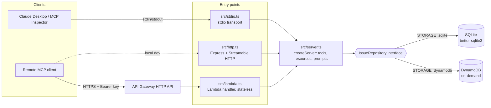
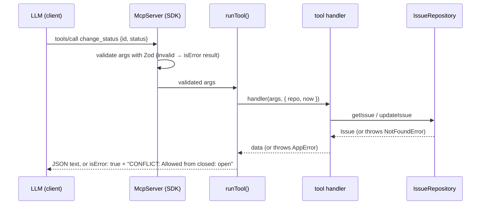
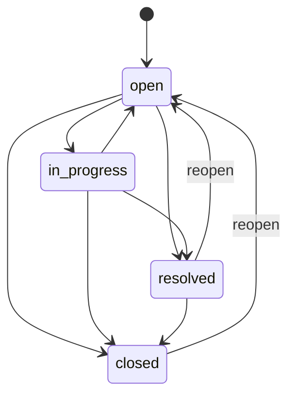

# Issue Tracker MCP Server

An [MCP (Model Context Protocol)](https://modelcontextprotocol.io) server that lets an LLM such as Claude
create, search, triage and report on software issues. It runs **locally over stdio** (Claude Desktop,
MCP Inspector) and **remotely over Streamable HTTP** on AWS Lambda, backed by SQLite or DynamoDB.

> Built as a learning and interview-portfolio project: the code is commented to explain _why_, not just _what_.

## Build status

| Phase | Scope                                                        | Status  |
| ----- | ------------------------------------------------------------ | ------- |
| 1     | Project setup, data model, SQLite repository                 | ✅ Done |
| 2     | MCP tools, resources, prompts + stdio transport              | ✅ Done |
| 3     | Vitest tests + MCP Inspector instructions                    | ✅ Done |
| 4     | Streamable HTTP transport, API-key auth, logging, rate limit | ⏳ Next |
| 5     | DynamoDB repository, Lambda handler, IaC, CI/CD              | ⏳      |

## Architecture (target)



All three entry points share **one** `createServer()` function, so tool behaviour is identical whichever
transport is used. Only the wiring differs.

## Tech stack

- **Node.js 22**, TypeScript (strict, plus `noUncheckedIndexedAccess`), native ES modules
- **@modelcontextprotocol/sdk** (`McpServer`, `registerTool` / `registerResource` / `registerPrompt`)
- **Zod 4** for validation, the single source of truth for types
- **better-sqlite3** (local) / **AWS SDK v3 DynamoDB** (production)
- **Vitest**, ESLint (typescript-eslint, type-aware), Prettier

> **Why Node 22 and not Node 20?** Node 20 reached end-of-life in April 2026, and current releases of
> Vitest require Node ≥ 22. Node 22 is the active LTS line and a supported AWS Lambda runtime.

## Project structure

```text
src/
  server.ts                  # createServer(): registers tools, resources, prompts (transport-agnostic)
  stdio.ts                   # stdio entry point (Claude Desktop, MCP Inspector)
  context.ts                 # AppContext { repo, now } injected everywhere
  config.ts                  # env vars → typed, validated config (fail fast)
  models/
    issue.ts                 # Zod schemas + derived types, limits, label helpers
    workflow.ts              # status transitions + priority definitions (single source)
  tools/
    types.ts                 # ToolDefinition: metadata + Zod shape + handler
    runTool.ts               # result/error → CallToolResult (isError: true)
    schemas.ts               # shared field schemas with .describe()
    format.ts                # description truncation for list/search output
    createIssue.ts … deleteIssue.ts   # one file per tool
  resources/                 # issues://summary, issues://workflow
  prompts/                   # triage_issues, weekly_report
  db/
    IssueRepository.ts       # storage interface (the contract)
    index.ts                 # createRepository(): picks backend from STORAGE
    sqlite/
      schema.ts              # tables + PRAGMA user_version migrations
      SqliteIssueRepository.ts
  lib/
    errors.ts                # AppError + NotFound/Validation/Conflict/Config
    ids.ts                   # short prefixed IDs (iss_…, cmt_…)
  # coming next: http.ts (phase 4), lambda.ts (phase 5)
tests/
  helpers.ts                 # controllable clock + in-memory repository
  db/repositoryContract.ts   # behaviour every IssueRepository must have (reused for DynamoDB)
  db/sqliteRepository.test.ts
  tools/                     # handler, runTool and input-schema tests
  prompts/ resources/ models/
  server.test.ts             # full MCP protocol via in-memory client ↔ server
scripts/seed.ts              # demo data for Inspector / Claude Desktop
examples/claude_desktop_config.json
infra/                       # phase 5
.github/workflows/ci.yml     # format, lint, typecheck, test + coverage, build on every push / PR
```

## How MCP works in this project

MCP gives an LLM three kinds of capability. They differ by **who decides to use them**:

| Primitive     | Who triggers it                               | Side effects?  | In this project                                          |
| ------------- | --------------------------------------------- | -------------- | -------------------------------------------------------- |
| **Tools**     | The **model** decides to call them            | Yes (some)     | 8 tools to create, read, update, comment, search, delete |
| **Resources** | The **app / user** attaches them as context   | No (read-only) | `issues://summary`, `issues://workflow`                  |
| **Prompts**   | The **user** picks them (like slash commands) | No             | `triage_issues`, `weekly_report`                         |

### Tools

| Tool            | Use it to…                                                                | Hints       |
| --------------- | ------------------------------------------------------------------------- | ----------- |
| `create_issue`  | track new work (search first to avoid duplicates)                         |             |
| `get_issue`     | read one issue in full, with comments                                     | read-only   |
| `list_issues`   | filter by status / priority / assignee / label                            | read-only   |
| `search_issues` | find issues by words in title or description                              | read-only   |
| `update_issue`  | change title, description, priority, assignee (`null` = unassign), labels | idempotent  |
| `change_status` | move through the workflow; illegal moves are rejected                     | idempotent  |
| `add_comment`   | record progress or the reason for a change                                |             |
| `delete_issue`  | permanently delete, **only with `confirm: true`**                         | destructive |

How a tool call flows:



Every tool is a plain object (`name`, `description`, Zod `inputSchema`, `annotations`, `handler`), see
[`src/tools/types.ts`](src/tools/types.ts). Handlers return data or throw; `runTool()` alone decides how
results and errors look on the wire.

### Status workflow



Defined once in [`src/models/workflow.ts`](src/models/workflow.ts). `change_status` enforces it, and
`issues://workflow` renders it as markdown, so the docs the model reads always match the behaviour.

### Prompts

- **`triage_issues`** (`team?`: comma-separated usernames): loads all open issues and the current
  workload per person, and asks the model for a priority/assignee table. It tells the model **not** to
  apply anything until the user approves (human in the loop).
- **`weekly_report`** (`since?`: `YYYY-MM-DD`, default Monday of this week, UTC): loads issues
  created, resolved/closed, and still open, and asks for a short structured report.

Both embed issue data inside `<issues>` blocks and tell the model to treat it as data, not
instructions, a basic defence against prompt injection through issue text.

## Data model

| Issue         | Type                                              | Notes                                      |
| ------------- | ------------------------------------------------- | ------------------------------------------ |
| `id`          | string                                            | `iss_` + 12 hex chars                      |
| `title`       | string                                            | ≤ 200 chars                                |
| `description` | string                                            | ≤ 10 000 chars                             |
| `status`      | `open` \| `in_progress` \| `resolved` \| `closed` | new issues are always `open`               |
| `priority`    | `low` \| `medium` \| `high` \| `critical`         |                                            |
| `assignee`    | string \| null                                    | `null` = unassigned                        |
| `labels`      | string[]                                          | trimmed, lower-cased, de-duplicated, ≤ 20  |
| `createdAt`   | ISO-8601 UTC                                      |                                            |
| `updatedAt`   | ISO-8601 UTC                                      | bumped on every change, including comments |

| Comment     | Type         | Notes                  |
| ----------- | ------------ | ---------------------- |
| `id`        | string       | `cmt_` + 12 hex chars  |
| `issueId`   | string       | FK, cascades on delete |
| `author`    | string       | ≤ 100 chars            |
| `text`      | string       | ≤ 5 000 chars          |
| `createdAt` | ISO-8601 UTC |                        |

## Key design decisions

1. **Repository pattern.** Tools never touch SQL or DynamoDB directly; they call `IssueRepository`.
   The backend is chosen by `STORAGE=sqlite|dynamodb`, and the same test suite can run against both.
2. **Async interface over a sync driver.** better-sqlite3 is synchronous, but DynamoDB is not, so the
   interface is `Promise`-based. Declaring the SQLite methods `async` also means errors always surface
   as rejected promises, the same as with DynamoDB.
3. **Lazy backend loading.** `createRepository()` uses dynamic `import()`, so the Lambda bundle never
   loads the native SQLite addon.
4. **Zod as the source of truth.** Enums, limits and types are defined once in `models/issue.ts` and
   reused by tools, repositories and tests, so validation and types can't drift apart.
5. **LLM-friendly IDs.** Short prefixed IDs (`iss_3f9a1c2b7d4e`) are easier for a model to copy
   between tool calls than 36-character UUIDs, and random IDs work in DynamoDB (which has no sequences).
6. **Clear error contract.** Reads return `null` when an issue is missing; writes throw `NotFoundError`.
   Every `AppError` has a stable `code`, which later becomes an `isError: true` MCP result the LLM can act on.
7. **Guardrails at the data layer.** SQL uses bound parameters only; `LIKE` wildcards are escaped
   (searching `100%` matches the literal text); list limits are clamped to 1–200; SQLite `CHECK`
   constraints reject invalid statuses and priorities; foreign keys are switched on explicitly
   (SQLite leaves them off by default).
8. **Labels as a JSON column.** Labels are queried with `json_each()` instead of a join table. This
   mirrors how DynamoDB will store them and is plenty fast at this scale.
9. **Simple search.** A case-insensitive `LIKE` over title and description. SQLite FTS5 or OpenSearch
   would be the upgrade path, but they are overkill for a team-sized tracker and would not port to DynamoDB.
10. **Tool descriptions are prompt engineering.** Each description says _when_ to use the tool and
    which sibling to use instead (e.g. `update_issue` points to `change_status` for status changes).
    Every input field has `.describe()`, because that text becomes the JSON Schema the model reads.
11. **Errors the model can act on.** Failures come back as `isError: true` results with a code and
    a fix hint ("Allowed from closed: open"), not protocol errors, so the model can self-correct.
    Unexpected errors return a generic message; details go to stderr only.
12. **Token-aware output.** List and search results truncate descriptions to 200 characters and add
    a note when the limit was hit; `get_issue` returns the full text. Tool output fills the context window.
13. **Guardrail on destructive actions.** `delete_issue` requires `confirm: true` and is annotated
    `destructiveHint`; its description steers the model towards closing instead.
14. **One status path.** `update_issue` cannot change status (unknown fields are rejected), so every
    status change goes through the workflow check in `change_status`.
15. **Absolute default DB path.** Claude Desktop launches servers from an unpredictable working
    directory, so the default `SQLITE_PATH` resolves to `<project>/data/issues.db`, not `./data`.

**Known limitation:** there is no status history, so `weekly_report` counts an issue as "resolved this
week" if it is currently resolved/closed and was last updated this week. A `resolvedAt` field or an
activity log would make this exact.

## Local setup

```bash
nvm use            # Node 22 (see .nvmrc)
npm install
npm run build
npm run dev:stdio  # run from source with tsx (speaks MCP on stdin/stdout)
```

The SQLite database is created automatically on first use (default `<project>/data/issues.db`,
git-ignored), and schema migrations run on startup. Environment variables are passed by the MCP
client (for example the `env` block in Claude Desktop's config) or your shell. `.env.example` lists them.

| Script                  | What it does                                 |
| ----------------------- | -------------------------------------------- |
| `npm run dev:stdio`     | run the stdio server from TypeScript (tsx)   |
| `npm run start:stdio`   | run the compiled server (`dist/stdio.js`)    |
| `npm run build`         | compile `src/` to `dist/`                    |
| `npm run lint`          | ESLint (type-aware)                          |
| `npm run typecheck`     | `tsc --noEmit` over src and tests            |
| `npm test`              | Vitest                                       |
| `npm run test:coverage` | Vitest with coverage + thresholds            |
| `npm run seed`          | add demo issues (only if the DB is empty)    |
| `npm run inspector`     | build, then open MCP Inspector on the server |

## Environment variables

| Variable      | Default                    | Description                                |
| ------------- | -------------------------- | ------------------------------------------ |
| `STORAGE`     | `sqlite`                   | `sqlite` or `dynamodb` (phase 5)           |
| `SQLITE_PATH` | `<project>/data/issues.db` | SQLite file path; `:memory:` for throwaway |

## CI/CD

[`.github/workflows/ci.yml`](.github/workflows/ci.yml) runs on every push and pull request:
`npm ci` → format check → lint → typecheck → tests with coverage → build. It has read-only
permissions and cancels superseded runs. Deployment to AWS is a separate workflow that runs only on
`main` (phase 5).

Branching follows GitHub Flow: one short-lived branch per phase (`2-mcp-tools-stdio`, …), a pull request
into `main`, CI must pass, then squash merge.

## Testing

### Automated tests (Vitest)

```bash
npm test               # ~120 tests, under a second
npm run test:coverage  # same, plus coverage report (coverage/index.html); CI fails below the floor
```

The suite is layered so each kind of failure shows up in exactly one place:

| Layer                 | File(s)                              | What it proves                                                                                                  |
| --------------------- | ------------------------------------ | --------------------------------------------------------------------------------------------------------------- |
| Repository contract   | `tests/db/repositoryContract.ts`     | Behaviour any storage backend must have: filters, ordering, partial updates, cascades, search escaping, summary |
| SQLite specifics      | `tests/db/sqliteRepository.test.ts`  | File persistence, migrations, foreign keys, `CHECK` constraints                                                 |
| Models                | `tests/models/models.test.ts`        | Label normalisation, limit clamping, the full status-transition matrix, config validation                       |
| Tool handlers         | `tests/tools/tools.test.ts`          | Each tool's happy path and failure modes (not found, illegal transition, delete without confirm)                |
| Error mapping         | `tests/tools/runTool.test.ts`        | `AppError` → `isError` with code; unexpected errors never leak details                                          |
| Input validation      | `tests/tools/schemas.test.ts`        | Size limits, trimming, enums: the guardrail between the LLM and the database                                    |
| Prompts and resources | `tests/prompts/`, `tests/resources/` | Weekly window maths, report grouping, triage content, injection data blocks, workflow docs                      |
| Protocol              | `tests/server.test.ts`               | A real MCP `Client` over `InMemoryTransport`: listing, JSON Schema descriptions, SDK validation                 |

Design choices worth knowing:

- **No mocks of our own code.** Tests use a real SQLite `:memory:` database. It's fast (the whole
  suite runs in under a second) and catches real SQL bugs that mocks would hide.
- **Deterministic time.** A controllable clock is injected into the repository and prompts, so
  ordering and "this week" logic never depend on when the tests run.
- **A contract suite.** `describeRepositoryContract()` takes a factory, so the DynamoDB repository in
  phase 5 must pass the same tests. That's the proof the backends are interchangeable.

### Manual testing with MCP Inspector

[MCP Inspector](https://github.com/modelcontextprotocol/inspector) is the official debugging UI for MCP
servers: it lists tools, resources and prompts, and lets you call them with a form.

```bash
npm run seed       # optional: 7 realistic demo issues
npm run inspector  # builds, then opens http://localhost:6274 in your browser
```

In the Inspector UI the transport is already set to **STDIO** with `node dist/stdio.js`. Click
**Connect**, then try:

1. **Tools → list_issues** with `status = open`: shortened descriptions, newest first.
2. **Tools → change_status** on a closed issue with `status = resolved`: an `isError` result
   explaining that only `open` is allowed.
3. **Tools → delete_issue** with `confirm` unchecked: refused.
4. **Resources → issues://summary** and **issues://workflow**.
5. **Prompts → triage_issues** with `team = alice, bob`: the fully rendered prompt text.
6. The **History** pane shows every JSON-RPC request and response, which is useful for seeing exactly what
   an LLM client would receive.

Inspector also has a scriptable CLI mode, handy for quick checks:

```bash
npx @modelcontextprotocol/inspector --cli node dist/stdio.js --method tools/list
npx @modelcontextprotocol/inspector --cli node dist/stdio.js \
  --method tools/call --tool-name search_issues --tool-arg keyword=payment
npx @modelcontextprotocol/inspector --cli node dist/stdio.js \
  --method resources/read --uri issues://summary
```

> Recent Inspector releases ask for Node ≥ 22.23. Older 22.x versions still work but print an
> `EBADENGINE` warning; `nvm install 22` gets the latest 22.x.

### Using it from Claude Desktop

1. `npm run build` (Claude Desktop runs the compiled `dist/stdio.js`).
2. Open **Settings → Developer → Edit Config** (this edits `claude_desktop_config.json`) and add the
   block from [`examples/claude_desktop_config.json`](examples/claude_desktop_config.json):

   ```json
   {
     "mcpServers": {
       "issue-tracker": {
         "command": "/ABSOLUTE/PATH/TO/node",
         "args": ["/ABSOLUTE/PATH/TO/issue-tracker-mcp/dist/stdio.js"],
         "env": {
           "STORAGE": "sqlite",
           "SQLITE_PATH": "/ABSOLUTE/PATH/TO/issue-tracker-mcp/data/issues.db"
         }
       }
     }
   }
   ```

3. Fully quit and restart Claude Desktop. The `issue-tracker` server and its tools show up in the
   chat's tools/connectors menu; its prompts and resources can be added to a chat from the same
   area.
4. Try: _"What critical issues are open?"_, _"Start working on the checkout timeout and note that
   the SDK timeout is the cause"_, or run the **weekly_report** prompt.

Gotchas this config avoids:

- **Use absolute paths everywhere.** Claude Desktop does not start in the project folder and does
  not load your shell profile, so `node` from nvm is often not on its `PATH`. Find yours with
  `which node`.
- **Use the same Node major version you ran `npm install` with.** better-sqlite3 is a native addon
  compiled for one Node ABI; running it with a different major version fails with
  `NODE_MODULE_VERSION` errors.
- Logs are in `~/Library/Logs/Claude/mcp-server-issue-tracker.log` (macOS).

### Using it from Claude Code

```bash
claude mcp add issue-tracker -- node /ABSOLUTE/PATH/TO/issue-tracker-mcp/dist/stdio.js
```

_Sections still to come: Streamable HTTP and auth (phase 4), AWS deployment and budget alert, interview
talking points (phase 5)._
